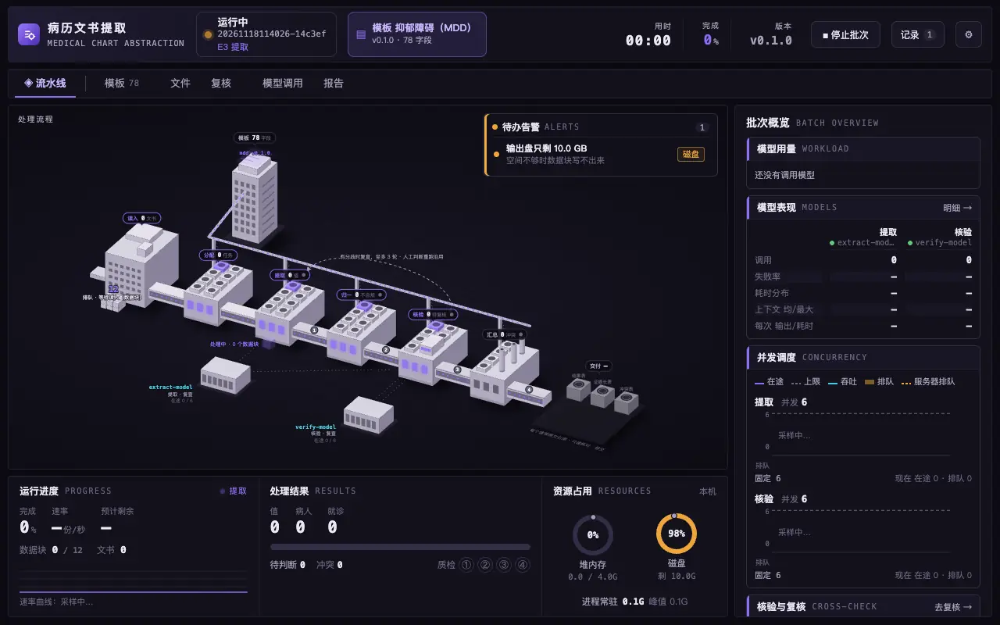
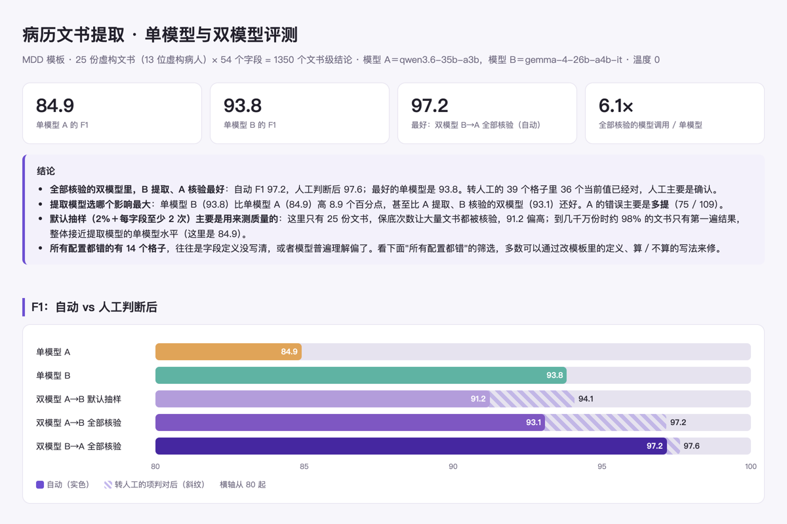

<div align="center">

# Medical Chart Abstraction Pipeline · dsh-medical-extract

**Extract template-defined fields from clinical notes, with every value traceable to the exact sentence it came from.**

[简体中文](https://github.com/wld007/dsh-medical-extract/blob/main/README.md) · English

A DeepSeek Harness plugin · two-model cross-checking · built for tens of millions of documents · notes go only to your own model endpoints

[](https://www.npmjs.com/package/dsh-medical-extract)




<sub>Recorded with synthetic data (`test/fixtures`) and a local mock model endpoint: 1,200 documents in 12 data blocks, then the Pipeline, Template, Review and Report tabs. Re-record with `scripts/readme-demo.mjs`. The UI is in Chinese.</sub>

</div>

---

## What it does

Give it an **extraction template** (a list of fields). The plugin reads the clinical notes, fills in each field, and delivers analysis-ready wide tables:

```
De-identification → [Chart abstraction] → wide tables / time-point table / evidence table → research statistics, cohorts, training data…
```

- **Every value is traceable**: each value carries a verbatim quote and its character offsets. The plugin locates the quote in the source text itself; positions reported by the model are never used. A value whose quote cannot be found in the source is discarded.
- **Assertion-aware**: present, negated, possible, historical, family and planned mentions are kept apart, so "denies suicidal ideation" is never counted as "has suicidal ideation".
- **Two-model cross-checking**: an extraction model and a verification model read independently; disagreements are re-examined by both, and only unresolved ones go to a human (see [below](#two-model-cross-checking)).
- **No disease knowledge in the engine**: all disease content lives in templates. Seven templates are built in; you can write your own, also in Excel.
- **Scale**: parallel data blocks, resumable batches, content-addressed model-response cache; designed for tens of millions of documents.

## Two-model cross-checking

A single model over-extracts, misses things, and misreads, without telling you where. This plugin has two **different** models check each other, so human effort goes only where they genuinely disagree:

```
              ┌────── extraction model: reads every document, returns value + quote ──────┐
documents ─▶ ─┤                                                                          ├─▶ compare document-level conclusions
              └── verification model: same tasks on a sample (or all), read independently ─┘
                                                                                          │
                   agree    ─▶ accept                                                     │
                   disagree ─▶ re-examination: the extraction model sees the verifier's answer, the verifier
                                 then sees the extractor's revised answer; each checks the source text and either
                                 revises or holds. Accepted as soon as they agree (tagged "re-examined, round N");
                                 stops early when neither changes; at most 3 rounds (configurable 1–6)
                             ─▶ still disagree ─▶ human review (keep, switch to the other answer, or reject)
```

- **Independent**: both models get the same prompt and never see each other's first answer, so neither just goes along with the other.
- **Grounded in the source**: in re-examination each model sees the other's answer and quote and judges against the source text; it is not a vote.
- **Rules are a third party**: fields with explicit rules in the template are also matched by rules as a cross-check; a rule/model mismatch gets one round of re-examination by the extraction model.
- **Adjustable sampling**: by default 2% of documents are verified, plus at least 2 checks for every field with values. This **measures** per-field agreement (gate ③; fields below 0.9 are flagged "field definition needs work"). For high-stakes batches, verify everything.
- **Separate endpoints**: each model has its own endpoint and concurrency limit, and concurrency adapts to server-side queueing.
- **Format recognition is two-model too**: for generic files, the rule engine, the extraction model and the verification model each draft how to read each table; a draft is adopted automatically only when they agree. Disagreements are re-examined item by item; anything still unresolved waits on the Formats tab for a human. Decisions are stored in a local format library and reused.

## Evaluation: single model vs two models

Five configurations were compared on a synthetic gold standard (25 MDD documents, 13 patients × 54 fields = 1,350 document-level conclusions). Model A = qwen3.6-35b-a3b, model B = gemma-4-26b-a4b-it, temperature 0:



| Configuration | Accuracy | Precision | Recall | **F1** | Errors | To human | F1 after review | Model calls |
|---|---:|---:|---:|---:|---:|---:|---:|---:|
| Single model A | 91.9 | 79.8 | 90.8 | **84.9** | 109 | 5 | 84.9 | 82 |
| Single model B | 97.1 | 92.5 | 95.2 | **93.8** | 39 | 6 | 93.8 | 87 |
| Two models A→B, default sampling | 95.3 | 86.5 | 96.5 | **91.2** | 64 | 38 | 94.1 | 313 |
| Two models A→B, verify all | 96.2 | 88.3 | 98.4 | **93.1** | 51 | 57 | 97.2 | 442 |
| Two models B→A, verify all | 98.7 | 96.9 | 97.5 | **97.2** | 18 | 56 | 97.6 | 497 |

Findings:

- **Two models with full verification is best**: B extracting and A verifying lifts F1 from the best single model's 93.8 to **97.2** and cuts errors from 39 to 18. Most cells sent to a human were already correct, so review is mostly confirmation (97.6 after review).
- **Re-examination does fix errors**: with A→B verify-all it fixed 63 cells and broke 5; with B→A it fixed 23 and broke 2.
- **The choice of extraction model matters most**: single model B beats A by 8.9 points, and A's errors are mostly over-extraction. Put the stronger model in the extraction seat.
- **Cost**: full verification makes about 6× the model calls of a single model. Default sampling is mainly for measuring quality; at tens of millions of documents almost all documents keep their first-pass result.
- **The 14 cells every configuration got wrong** mostly come from unclear field definitions and are fixed by tightening the definition and the counts/does-not-count wording in the template.

The sample is small; differences of about 1 point between configurations are not meaningful. Full report (by field group, by field, every wrong cell, in Chinese): [docs/eval/2026-11-16-mdd.html](docs/eval/2026-11-16-mdd.html); how to re-run: [docs/eval/README.md](docs/eval/README.md).

## Built-in templates

Each follows Chinese and international guidelines (the template's `references` list the sources); field lists are in [docs/templates.md](docs/templates.md):

| Template id | Condition | Fields |
|---|---|---:|
| `mdd` | Major depressive disorder | 78 |
| `stroke-ais` | Acute ischemic stroke | 53 |
| `ad` | Alzheimer's disease and cognitive impairment | 63 |
| `hf` | Heart failure | 55 |
| `t2dm` | Type 2 diabetes | 51 |
| `ckd-hd` | Chronic kidney disease and hemodialysis | 57 |
| `nsclc` | Non-small cell lung cancer | 49 |

Custom templates: copy a template as your own in the page and edit it, or download it as Excel (or a blank template), edit in Excel, and import it back (format: [docs/template.md](docs/template.md) §9).

## Install and configure

Install `dsh-medical-extract` from the DeepSeek Harness plugin manager, then open Settings → 病历文书提取 (chart abstraction) and set:

- **Extraction model** (required): an OpenAI-compatible endpoint and model name, usually on the local machine or intranet. Batches cannot start without it.
- **Verification model** (recommended): a second endpoint and model, which turns on two-model cross-checking.
- Default template, sampling rate, re-examination rounds, concurrency, and so on.

Clinical text is sent only to the endpoints configured here; agent tools cannot choose the endpoint, model or key.

## Usage

- **Sidebar entry 病历文书提取**: opens the pipeline page with Pipeline, Template, Formats, Files, Review, Model calls and Report tabs.
- **Chat**: `/extract <input dir or file> [--template mdd] [--mode hybrid|model] [--out output root] [--as-of "YYYY-MM-DD HH:mm"]`
- **Agent tools**: `extract_start`, `extract_status`, `extract_report`, `extract_runs`, `extract_cancel`, `extract_templates`, `extract_save_template`, `extract_formats`, `extract_template_excel`. You can ask the agent in chat to start a batch, check progress or read the report.

Two kinds of input:

- **Regional health-platform exports** (`p_doc_*.json`, one file per month, one or more patients): admission notes, discharge summaries, outpatient notes, exam reports and so on are split into sections. Structured tables (diagnoses, labs, encounters) are not extracted; only demographics and encounter information are taken from them.
- **Generic files** (json, ndjson, jsonl, csv, tsv, xlsx, txt, md): each line or each file is one document; ndjson files over 32 MB are split by byte range and read in parallel.
  - **Format recognition**: each table is profiled locally to identify record type, written time, patient, encounter and sections (two-model drafting, see above). Only field names, statistics and at most 3 samples cut to 20 characters are sent; narrative and pseudonym fields send no samples. Tables already adopted by the medical-event plugin are borrowed directly.
  - **Data-element dictionary** (optional, `elementDict`): when field names are data-element codes, their Chinese names are added to the profile.
  - Exports with one folder per patient (what the de-identification plugin produces) are recognized automatically.

## Pipeline and quality gates

| Stage | What it does | Gate |
|---|---|---|
| E0 Template | Validate the template (`extract-template/1`); compile keywords, rules and options | Does not run if validation fails |
| E1 Read · clean | Read documents only; decode embedded content, strip export garbage, split sections, drop empty documents | — |
| E2 Assign | Decide which fields each document is read for, by document type and section; group fields, split long documents by section into extraction tasks | — |
| E3 Extract | The extraction model reads each task and returns values, assertion and verbatim quotes; fields with explicit rules are also matched by rules as a cross-check | ① The quote must appear verbatim in the source and support the value, otherwise the value is discarded |
| E4 Normalize | Convert units, normalize dates, map options to canonical names; check type, options and range | ② Values must fit type, options and range |
| E6 Verify · re-examine | Two-model verification and re-examination (see above) | ③ Per-field sampled agreement before re-examination ≥ 0.9 |
| E5 Roll up | Roll values up into cells per patient, encounter, document or time point; compute derived fields; record conflicts without picking a side | ④ Every cell traces to values, every value traces to the source |
| E7 Deliver | Write wide tables, long tables, conflict table and manifest (plus result.xlsx for small batches); confirm sources were read-only | — |

Two modes: `hybrid` (default: model reads everything, rules cross-check) and `model` (model only). A field can set `model: never` to use rules only.

## Deliverables

Under `<output root>/output/<input name>/` (downstream reads only `output`; re-running the same input replaces it with the latest result):

| File | Content |
|---|---|
| `wide_patient.csv`, `wide_encounter.csv` (, `wide_document.csv`) | Wide tables, one row per patient, encounter (or document); one column per field plus `<field>__n` evidence counts |
| `timepoints.csv` | Time-point fields (scales, labs…), one value per row |
| `evidence/part-*.ndjson.gz` | Evidence table: value, assertion, quote, offsets, section, document, written time, method (`rule:<rule>` / `model` / `model+rule`), flags |
| `conflicts.csv` | Conflicting cells with each side's values and evidence ids |
| `fields.csv`, `template.json`, `manifest.json` | Field descriptions, the template used, counts and gates |

Records live in `<output root>/_records/`: `records.sqlite` (batches, data blocks, model cache, call statistics, human decisions) and `runs/<batch>/report.md|json`. Human decisions are stored under stable ids and carried over to re-runs.

## Scale

- **Data blocks**: documents are cut into data blocks processed by worker threads (default: CPU count minus 1, up to 8). After cancellation or failure, continue with `resumeFrom`; finished blocks and model calls are reused.
- **Model calls**: globally rate-limited, with concurrency adapted to server queueing. Responses are cached by sha256(model + prompt), so identical passages are sent once, across batches.
- **Roll-up**: bucketed by patient hash and run in parallel; memory does not grow with total volume.
- **Throughput**: local reading and rule work run at about 20,000 documents/s (11-core Mac); overall speed depends on model-endpoint throughput and cache hit rate.

## Principles

Shared by the dsh-medical plugin family: never modify input; clinical text goes only to configured model endpoints; model-reported positions are never used; no imputation, unwritten means "not mentioned"; stable ids; supports an as-of cutoff (`asOf`).

## Development

```sh
node --test test/*.test.mjs                 # tests (synthetic data)
node scripts/build-templates.mjs            # templates/src/*.mjs → templates/*.json (validated first)
node scripts/build.mjs 0.1.0-dev.1          # build dist/<version>, then install it from the profile
REACT_UMD_DIR=<node_modules with react/umd> node scripts/preview-page.mjs <stateDir>   # preview the page outside DSH

# Re-record the README animation (synthetic data + local mock model endpoint)
REACT_UMD_DIR=… PLAYWRIGHT_DIR=<node_modules with playwright> node scripts/readme-demo.mjs /tmp/mx-demo
python3 scripts/readme-demo.py /tmp/mx-demo assets/demo.webp
```

## License

MIT
