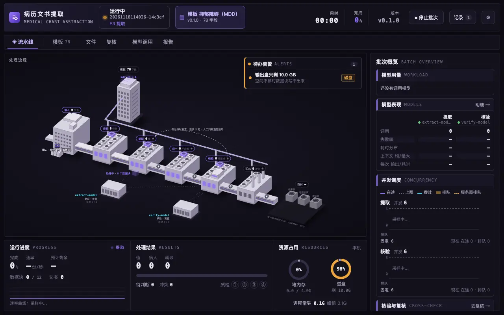
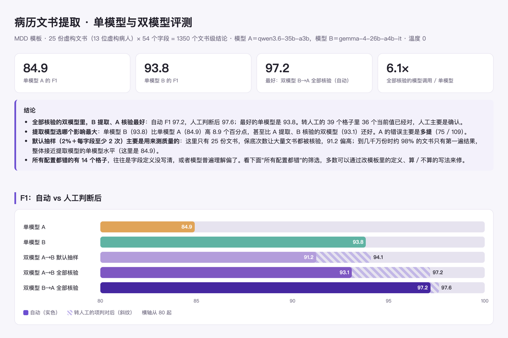

<div align="center">

# 病历文书提取流水线 · dsh-medical-extract

**按模板从病历文书里提取字段（chart abstraction），每个值都能回到原文那一句。**

简体中文 · [English](https://github.com/wld007/dsh-medical-extract/blob/main/README.en.md)

DeepSeek Harness 插件 · 双模型交叉核验 · 面向千万级文书 · 病历只发往你自己的模型端点

[](https://www.npmjs.com/package/dsh-medical-extract)




<sub>动画用虚构数据（`test/fixtures`）和本机假模型端点录制：1,200 份文书、12 个数据块，依次看流水线、模板、复核、报告。用 `scripts/readme-demo.mjs` 可重录。</sub>

</div>

---

## 它做什么

给一份**提取模板**（字段清单），插件读病历文书，把字段一个个填出来，交付成可以直接统计的宽表：

```
医疗数据匿名化 → 【病历文书提取】 → 宽表／时间点长表／证据长表 → 科研统计、队列、训练数据……
```

- **每个值可回溯**：值带逐字原文引用和起止位置，位置由插件自己在原文里找，模型给的位置一律不用。原文里找不到引用的值直接丢弃。
- **区分提及方式**：有、否认、可疑、既往、家族、计划分开记。"否认自杀观念"不会被算成"有自杀观念"。
- **双模型交叉核验**：提取模型和核验模型各自独立通读，不一致就互相复查，仍不一致才转人工（见[下文](#双模型交叉核验)）。
- **引擎里没有病种知识**：病种内容全部在模板里。内置 20 个模板，也可以自建或在 Excel 里写。
- **规模**：数据块并行、断点续跑、模型回复按内容缓存，按千万份文书设计。

## 双模型交叉核验

单个模型会多提、漏提、读偏，而且不会告诉你哪里错了。本插件用两个**不同的**模型互相检查，把人工只留给真正有分歧的地方：

```
            ┌──────────── 提取模型：通读每份文书，给值＋原文引用 ────────────┐
文书 ──分配──┤                                                              ├─→ 比较文书级结论
            └──── 核验模型：抽样（或全部）同样的任务，独立再读一遍，互不可见 ────┘
                                                                             │
                     一致 ─→ 采用                                             │
                     不一致 ─→ 复查：提取模型看核验模型的答案，核验模型再看提取模型的新答案，
                                    对照原文改或坚持；任一轮一致即采用（标「复查第 N 轮」），
                                    双方都不改就提前停，至多 3 轮（可设 1–6）
                                  ─→ 仍不一致 ─→ 转人工复核（页面上可维持、改用、不采用）
```

- **独立**：同一份提示，两个模型各自作答，看不到对方，避免"附和"。
- **对照原文复查**：复查时给出对方的答案和原文引用，让模型对着原文判断，而不是投票。
- **规则也是一方**：模板里写了明确规则的字段，规则再匹配一次作对照；规则与模型不符只让提取模型复查 1 轮。
- **抽样可调**：默认按文书抽 2%，另保证每个有值字段至少核验 2 次，用来**测**各字段的一致率（质检③，低于 0.9 的字段标"需要改字段定义"）；对质量要求高的批次可以全部核验。
- **两个端点分开**：提取模型和核验模型各配端点和并发上限，各自自动调节并发（看服务器排队情况）。
- **格式识别同样双模型**：通用文件的每张表，规则、提取模型、核验模型各起草一份读法，一致才自动采用，有分歧的逐项复查，仍不一致停在「格式」页由人确认，结果存进本机格式库复用。

## 评测：单模型 vs 双模型

用虚构金标准（25 份 MDD 文书、13 位病人 × 54 个字段 = 1,350 个文书级结论）比较了五种配置，模型 A＝qwen3.6-35b-a3b，模型 B＝gemma-4-26b-a4b-it，温度 0：



| 配置 | 准确率 | 精确率 | 召回率 | **F1** | 错 | 转人工 | 人工后 F1 | 模型调用 |
|---|---:|---:|---:|---:|---:|---:|---:|---:|
| 单模型 A | 91.9 | 79.8 | 90.8 | **84.9** | 109 | 5 | 84.9 | 82 |
| 单模型 B | 97.1 | 92.5 | 95.2 | **93.8** | 39 | 6 | 93.8 | 87 |
| 双模型 A→B 默认抽样 | 95.3 | 86.5 | 96.5 | **91.2** | 64 | 38 | 94.1 | 313 |
| 双模型 A→B 全部核验 | 96.2 | 88.3 | 98.4 | **93.1** | 51 | 57 | 97.2 | 442 |
| 双模型 B→A 全部核验 | 98.7 | 96.9 | 97.5 | **97.2** | 18 | 56 | 97.6 | 497 |

结论：

- **双模型全部核验最好**：B 提取、A 核验，F1 从最好的单模型 93.8 提到 **97.2**，错误从 39 个降到 18 个；转人工的格子里大多数当前值已经对了，人工主要是确认（人工后 97.6）。
- **复查确实在修错**：A→B 全部核验时复查修好 63 格、改坏 5 格；B→A 修好 23 格、改坏 2 格。
- **提取模型选哪个影响最大**：单模型 B 比 A 高 8.9 个百分点；A 的错误主要是多提。把强的模型放在提取位。
- **代价**：全部核验的模型调用约是单模型的 6 倍。默认抽样主要用来测质量，到千万份时绝大多数文书只有第一遍结果。
- **所有配置都错的 14 格**多半是字段定义没写清，改模板里的定义和"算／不算"写法就能修。

样本小，两个配置相差 1 个百分点左右不算有差别。完整报告（按字段组、逐字段、每个出错的格子）：[docs/eval/2026-11-16-mdd.html](docs/eval/2026-11-16-mdd.html)；重跑方法见 [docs/eval/README.md](docs/eval/README.md)。

## 内置模板

均按国内外指南整理（模板里的 `references` 记着依据），字段清单见 [docs/templates.md](docs/templates.md)：

| 模板 id | 病种 | 字段数 |
|---|---|---:|
| `mdd` | 抑郁障碍（MDD） | 78 |
| `stroke-ais` | 急性缺血性卒中 | 53 |
| `ad` | 阿尔茨海默病与认知障碍 | 63 |
| `hf` | 心力衰竭 | 55 |
| `t2dm` | 2 型糖尿病 | 51 |
| `ckd-hd` | 慢性肾脏病与血液透析 | 57 |
| `nsclc` | 非小细胞肺癌 | 49 |
| `htn` | 高血压 | 61 |
| `cad` | 冠心病（含 ACS／PCI） | 67 |
| `af` | 心房颤动 | 56 |
| `copd` | 慢性阻塞性肺疾病 | 73 |
| `bc` | 乳腺癌 | 61 |
| `crc` | 结直肠癌 | 67 |
| `hcc` | 原发性肝癌 | 64 |
| `thyroid` | 甲状腺疾病（甲亢／甲减／结节） | 56 |
| `op` | 骨质疏松症 | 46 |
| `gout` | 高尿酸血症与痛风 | 56 |
| `dlp` | 血脂异常 | 52 |
| `asthma` | 支气管哮喘 | 61 |
| `chb` | 慢性乙型肝炎与肝硬化 | 71 |

自建模板：页面上"复制为我的模板"后改，或者"下载 Excel"／"空白模板"，在 Excel 里写好再"导入 Excel"（格式见 [docs/template.md](docs/template.md) §9）。

## 安装与配置

在 DeepSeek Harness 的插件管理里安装 `dsh-medical-extract`，然后在设置 →「病历文书提取」里配置：

- **提取模型**（必填）：OpenAI 兼容端点＋模型名，通常是本机或内网部署的模型。没有配置时不能运行。
- **核验模型**（建议）：另一个端点＋模型，开启双模型核验。
- 默认模板、抽样比例、复查轮次、并发等。

病历内容只发往这里配置的端点；Agent 工具不能选择端点、模型或 Key。

## 用法

- **左侧栏「病历文书提取」**：打开「病历文书提取流水线」页面，有流水线、模板、格式、文件、复核、模型调用、报告几页。
- **聊天框**：`/extract <输入目录或文件> [--template mdd] [--mode hybrid|model] [--out 输出根目录] [--as-of "YYYY-MM-DD HH:mm"]`
- **Agent 工具**：`extract_start`、`extract_status`、`extract_report`、`extract_runs`、`extract_cancel`、`extract_templates`、`extract_save_template`、`extract_formats`、`extract_template_excel`。在对话里可以直接让 Agent 启动批次、查进度、读报告。

输入支持两类：

- **区域平台导出**（`p_doc_*.json`，按月分文件，一位或多位病人）：入院、出院、门诊病历、检查报告等文书按栏目切开；诊断、检验、就诊等结构化表不提取，只从中取人口与就诊信息。
- **通用文件**（json、ndjson、jsonl、csv、tsv、xlsx、txt、md）：每行或每个文件算一份文书；超过 32 MB 的 ndjson 按字节区间切开并行读。
  - **格式识别**：按表在本机画像，识别记录类别、写成时间、病人、就诊和栏目（双模型起草，见上文）。只发字段名、统计、≤3 个截到 20 字的样例；叙述类字段和假名字段不发样例。病历事件还原插件已采用过的表直接借用。
  - **数据元对照表**（可选，`elementDict`）：字段名是数据元编码时，把中文名写进画像。
  - 一个文件夹一位病人的导出（匿名化插件的输出就是这样）自动认出来。

## 流水线与质检

| 环节 | 做什么 | 质检 |
|---|---|---|
| E0 模板 | 校验模板（`extract-template/1`），编译关键词、规则和选项 | 校验不过就不运行 |
| E1 读入·清洗 | 只读文书；解码嵌入内容、去掉导出乱码、切栏目，剔除空白文书 | — |
| E2 分配 | 按文书类型和栏目决定每份文书提取哪些字段；字段分组、长文书按栏目分段，切成提取任务 | — |
| E3 提取 | 提取模型通读，给出值、提及方式和逐字原文引用；有明确规则的字段规则再匹配一次作对照 | ① 原文引用必须逐字在原文里，且支持所取的值，否则丢弃 |
| E4 归一 | 换算单位、规范日期、选项归到规范名；按类型、选项、值域校验 | ② 值必须符合类型、选项和值域 |
| E6 核验·复查 | 双模型核验与复查（见上文） | ③ 各字段复查前的抽样一致率 ≥ 0.9 |
| E5 汇总 | 按病人、就诊、文书、时间点汇总成单元格；算计算字段；登记冲突，不自动选边 | ④ 每个单元格回溯到值，每个值回溯到原文 |
| E7 交付 | 写出宽表、长表、冲突表、manifest，小批次另附 result.xlsx；核对源文件只读 | — |

两种模式：`hybrid`（默认，模型通读＋规则对照）、`model`（只用模型）。字段可设 `model: never` 只走规则。

## 交付

`<输出根目录>/output/<输入名>/`（下游只读 `output`；同一输入重跑时以最新结果替换）：

| 文件 | 内容 |
|---|---|
| `wide_patient.csv`、`wide_encounter.csv`（、`wide_document.csv`） | 宽表，一行一位病人、一次就诊（或一份文书）；每个字段一列，另有 `<字段>__n` 列记证据数 |
| `timepoints.csv` | 时间点级字段（量表、检验等），一个值一行 |
| `evidence/part-*.ndjson.gz` | 证据长表：值、提及方式、原文引用、起止位置、栏目、文书、写成时间、方法（`rule:<规则>`／`model`／`model+rule`）、标记 |
| `conflicts.csv` | 冲突单元格，以及各方的值和证据编号 |
| `fields.csv`、`template.json`、`manifest.json` | 字段说明、所用模板、计数与质检 |

记录放在 `<输出根目录>/_records/`：`records.sqlite`（批次、数据块、模型缓存、调用统计、人工判断）和 `runs/<批次>/report.md|json`。人工判断按稳定编号存放，重跑时沿用。

## 规模

- **数据块**：文书切成数据块，工作线程并行处理（默认 CPU 数减 1，最多 8 个）。取消或失败后用 `resumeFrom` 继续，已完成的数据块和模型调用直接复用。
- **模型调用**：全局限流，按服务器排队情况自动调并发。回复按 sha256(模型＋提示) 缓存，相同片段只调用一次，各批次共用。
- **汇总**：按病人哈希分桶并行，内存不随总量增长。
- **吞吐**：本机读入与规则部分约 2 万份/秒（11 核 Mac）；整体速度取决于模型端点吞吐和缓存命中率。

## 原则

沿用 dsh-medical 插件家族的约定：绝不修改输入；病历内容只发往设置里的模型端点；模型给的位置一律不采用；不做补全，没写的就是"未提及"；编号稳定；支持截至时刻（`asOf`）。

## 开发

```sh
node --test test/*.test.mjs                 # 测试（虚构数据）
node scripts/build-templates.mjs            # templates/src/*.mjs → templates/*.json（先校验）
node scripts/build.mjs 0.1.0-dev.1          # 生成 dist/<版本>，再从 profile 安装
REACT_UMD_DIR=<含 react/umd 的 node_modules> node scripts/preview-page.mjs <stateDir>   # 在 DSH 之外预览页面

# 重录 README 动画（虚构数据＋本机假模型端点）
REACT_UMD_DIR=… PLAYWRIGHT_DIR=<含 playwright 的 node_modules> node scripts/readme-demo.mjs /tmp/mx-demo
python3 scripts/readme-demo.py /tmp/mx-demo assets/demo.webp
```

## 许可

MIT
